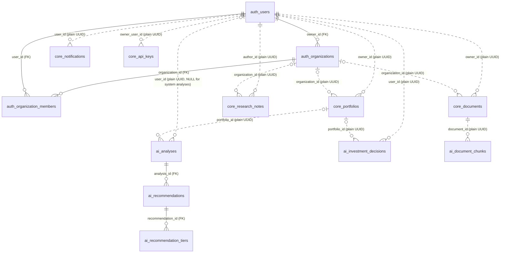
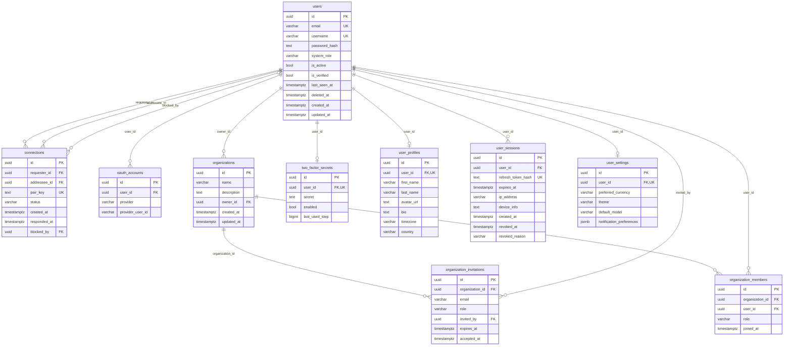

# AlphaMind — Entity Relationship Documentation

This document describes the schema as implemented in code: every table
below has a SQLAlchemy model behind it.

Schema changes are Alembic migrations only. Each service's chain starts at
a baseline that builds its whole schema, followed by a few later
migrations:

| Service | Chain (oldest -> head) |
|---|---|
| auth | `f1160b000001` (baseline) -> `f1190b000001` (`user_sessions.revoked_reason`) -> `f1210b000001` (drops `organization_roles`) |
| core | `f1160c000001` (baseline) -> `f1170c000001` (document unique indexes `NULLS NOT DISTINCT`; `api_keys` owned by a user only) -> `f1200c000001` (`event_outbox`) -> `f1250c000001` (`documents.status_changed_at`) |
| ai | `f1160a000001` (baseline) -> `f1170a000001` (drops four unused tables) -> `f1210a000001` (drops four write-only tables) -> `f1220a000001` (`filing_records`) -> `f1230a000001` (`kg_relations.kind`, `as_of`) -> `f1240a000001` (`recommendations.judge_leaning`, `judge_confidence`) -> `f1250a000001` (`agent_memories.user_id`) |

The files are under `services/<service>/migrations/versions/`; details in
`handbook/20-postgresql.md` section 3.5.

Sections 2 to 4 describe every table in words. Section 7 draws the same
tables and their foreign keys as diagrams, and section 8 shows how to
look at the live schema and its relations in Adminer.

## 1. Cross-Service Reference Rule

Each service owns one Postgres schema (`auth`, `core`, `ai`) in a single shared
Postgres instance. **No table in one schema may declare a real `FOREIGN KEY`
into another schema.** Cross-service references (e.g. `ai.analyses.user_id`
pointing conceptually at `auth.users.id`) are always a plain UUID column, never
a SQL foreign key. Integrity across the boundary is kept by the
application (internal API checks and events such as `portfolio.deleted`).

## 2. `auth` schema (auth-service)

**users** — `id`, `email` (unique), `username` (unique), `password_hash`,
`system_role` (default `"user"`; one of `admin`/`moderator`/`user`/`guest`,
permissions per role in `shared/permissions.py`), `is_active`,
`is_verified`, `last_seen_at`, `deleted_at` (nullable), timestamps. `deleted_at` marks an admin's soft
delete: the row stays so other services' plain-UUID references keep
resolving, `is_active` is false, `email`/`username` are replaced by
`deleted-<id>@deleted.alphamind.local` / `deleted_<id>`, the password by a
random one, and the user's profile fields, OAuth accounts, 2FA secret,
connections, organization memberships, sessions, open sent invitations
and (for a verified account) invitations addressed to the user's email are
removed. An organization the user owned passes to its longest-standing
active admin, else its longest-standing active member or viewer, else a
deactivated member in the same order; an organization with no other
member is deleted. The nightly `purge-unverified` job also removes these
auth leftovers (except invitations to the old address, which is no
longer known) for accounts deleted before this cleanup existed. A deleted
account can never log in again. The live `system_role` /
`is_active` of every user is mirrored in Redis (`auth:user_state:{id}`,
`shared/user_state.py`) so every service applies changes at once.

**user_profiles** — `id`, `user_id` (FK → users, 1:1), `first_name`,
`last_name`, `avatar_url`, `bio`, `timezone`, `country`.

**user_settings** — `id`, `user_id` (FK → users, 1:1), `preferred_currency`,
`theme`, `default_model` (unused, not exposed by the API),
`notification_preferences` (JSONB).

**user_sessions** — `id`, `user_id` (FK → users), `refresh_token_hash`
(unique; the refresh token itself is never stored), `expires_at`,
`ip_address`, `device_info`, `created_at`, `revoked_at`, `revoked_reason`
(nullable: `rotated` / `logout` / `revoked_all` / `reuse`). A session
created by a refresh has `created_at` equal to the `revoked_at` of the
session it replaced, which links a rotation chain without a separate
column. A `rotated` token presented again more than 30 seconds after its
rotation revokes the sessions descending from it (reason `reuse`; the
user's other sessions stay); within 30 seconds, and for any other reason
or none, it just gets a 401. A new session deletes the user's sessions that
expired more than 7 days ago.

**oauth_accounts** — `id`, `user_id` (FK → users), `provider`,
`provider_user_id`.

**two_factor_secrets** — `id`, `user_id` (FK → users, 1:1), `secret`,
`enabled`, `last_used_step` (the last accepted TOTP step; a code of that
step or earlier is rejected, so it cannot be replayed). `secret` holds the
encrypted value (`fernet:<token>`, see
`services/auth-service/security.py`); a value without that prefix, or
one the current keys cannot decrypt, is refused (409), never read as
plain text.

**organizations** — `id`, `name`, `description`, `owner_id` (plain UUID →
`users.id`, same-schema so this one *is* a real FK), timestamps.

**organization_members** — `id`, `organization_id` (FK), `user_id` (FK →
users), `role` (default `"member"`; one of the fixed roles `owner`,
`admin`, `member`, `viewer`), `joined_at`. There are no custom
organization roles.

**organization_invitations** — `id`, `organization_id` (FK), `email`, `role`,
`invited_by` (FK → users), `expires_at`, `accepted_at`. There is no
status column. An invitation can never carry the `owner` role (422 when
it is created).

**connections** — `id`, `requester_id` / `addressee_id` (FK → users),
`pair_key` (deterministic, order-independent pair identifier — lets a unique
constraint prevent duplicate connection requests in either direction without
a self-referential composite unique index), `status` (default `"pending"`),
`created_at`, `responded_at`, `blocked_by` (FK → users, `ON DELETE SET
NULL`: who blocked, the only user who may unblock).

## 3. `core` schema (core-service)

**portfolios** — `id`, `owner_id` (plain UUID, cross-schema), `organization_id`
(plain UUID, nullable), `name`, `currency` (default `"USD"`; validated
against the `Currency` enum `USD`/`EUR`/`GBP` at creation and used by
`GET /api/v1/portfolios/{id}/snapshots` for a display-only conversion
overlay, see `docs/API_SPEC.md` §3), `visibility` (default `"private"`),
`auto_analyze_at_open` (bool: re-analyze the holdings at market open),
timestamps.

**holdings** — `id`, `portfolio_id` (FK), `ticker`, `quantity` (NUMERIC),
`average_cost` (NUMERIC). This table is only a cache of the replayed
transaction ledger: holdings change only through ledger rows (the holding
API routes record `adjustment` transactions instead of writing here).

**transactions** — `id`, `portfolio_id` (FK), `ticker`, `transaction_type`
(`buy`/`sell`/`dividend`/`deposit`/`withdrawal`/`stock_split`/`adjustment`),
`quantity`,
`price`, `dividend_per_share` (only meaningful for `dividend`; a
dedicated column rather than overloading `price`), `split_ratio` (only
meaningful for `stock_split`, for the same reason; one real value covers a
forward split, a reverse split, and a stock dividend, since all three are
mechanically identical ratio-based rescales of an existing holding with
zero cash effect), `transaction_date`, `idempotency_key` (automated
fills). **`adjustment`**: shares moved in
(positive `quantity`) or out (negative `quantity`) at a per-share cost basis
(`price`, >= 0, required for shares in, may be NULL for shares out), with
**no cash effect** -- a transfer from another broker, a correction or an
opening position. Shares in move the average cost like a buy; shares out
leave it unchanged and cannot exceed the held quantity. Backtests and the
history export treat it as an external flow, never as return.
`transaction_type` is a plain VARCHAR and `quantity`/`price` are
unconstrained NUMERIC; the allowed values are checked by the application.

**portfolio_snapshots** — `id`, `portfolio_id` (FK), `snapshot_date`,
`total_value`, `cash_balance`.

**watchlists** — `id`, `owner_id` (plain UUID, cross-schema), `name`.

**watchlist_items** — `id`, `watchlist_id` (FK), `ticker`, unique on
`(watchlist_id, ticker)`.

**documents** — `id`, `owner_id` (plain UUID), `organization_id` (plain UUID,
nullable), `filename`, `document_type` (`pdf`/`txt`/`md` — file format),
**`category`** (`filing`/`analyst_report`/`earnings_call`/`news`/
`macro_research` — RAG-layer classification, a different axis from
`document_type`; user-supplied at upload since there's no reliable way to
infer document semantics from bytes alone), **`ticker`** (nullable — not
every category is about one company), `storage_url` (an object *key* into
S3-compatible object storage via `shared/storage.py`, not a fetchable URL — see §5 for why), and
`status` (`uploaded`→`parsing`→`chunking`→`embedding`→`ready`/`failed`,
driven by ai-service's ingestion workflow), `uploaded_at` (default `now()`),
`status_changed_at` (default `now()`, set on every applied status change;
the stuck-document rule measures from it),
`content_date` (nullable: the date of the content itself, for example a
filing's SEC filing date, set by automated ingestion). `category` and
`ticker` drive `ai/rag/chunking.py`'s category-aware chunking and
`ai/rag/retriever.py`'s ticker-scoped filtering. Nullable `title`
(VARCHAR(256), display title;
the list sorts by `coalesce(title, filename)`) and `source_url` (TEXT, where
a system document came from). A system document has the well-known owner
`00000000-0000-0000-0000-0000000005ec` (`is_system` in the API response is
derived from it, not stored). Two partial unique indexes stop a duplicate
upload per tenant: `(organization_id, ticker, category, filename)` where
`organization_id IS NOT NULL`, and `(owner_id, ticker, category, filename)`
where it is NULL; both are `NULLS NOT DISTINCT`, so a document without a
ticker (macro research) is covered too.

**research_notes** — `id`, `author_id` (plain UUID), `organization_id`
(nullable), `title`, `content`, `search_vector` (Postgres `TSVECTOR`,
generated column, full-text search), `yjs_state` (bytea — the collaborative
editing CRDT state), timestamps, plus the moderation and sentiment
columns below. Yjs is the source of truth for the body: the Yjs document's `Y.Text` named `"content"` is written back to
`content` (and so to `search_vector`) at every persist; title and tags are
not part of the Yjs document.

**research_comments** — `id`, `note_id` (FK), `author_id` (plain UUID),
`content`, `created_at`, `updated_at` (nullable: set when the author
edits the comment, NULL if never edited), plus the moderation and
sentiment columns below.

Moderation and sentiment columns, on both `research_notes` and
`research_comments`:
`is_hidden` (BOOLEAN NOT NULL, default false), `hidden_by` (plain UUID of the
moderator), `hidden_at` — set by a moderator; hidden rows are left out of
every list, search and detail except for their author and moderators —
and `sentiment_label` (VARCHAR(16): `positive`/`neutral`/`negative`),
`sentiment_score` (DOUBLE PRECISION, -1..1), `sentiment_model`
(VARCHAR(128)), `sentiment_analyzed_at` — all NULL until ai-service
(`POST /internal/sentiment`) has analysed the text once. After an edit
they keep the previous result until a refresh succeeds, so a failed
refresh leaves the previous label in place until the next successful
one. `scripts/backfill_sentiment.py --apply` fills rows that have no
label and also re-analyses rows whose label is older than the last edit.

**research_tags** — `id`, `name` (unique). **note_tags** — plain many-to-many
join table, `note_id` + `tag_id` (both FK).

**notifications** — `id`, `user_id` (plain UUID), `type`, `title`, `content`,
`read_at`, `created_at`. `type` is a plain string
(`shared/enums.py::NotificationType`), so a new type needs no
migration.

**api_keys** — `id`, `owner_user_id` (plain UUID, NOT NULL, indexed), `name`,
`key_hash` (unique), `rate_limit_per_minute`, `last_used_at`, `revoked_at`,
`created_at`. A key always belongs to one user; there is no organization
owner and no scopes.

**event_outbox** (migration `f1200c000001`) — transactional outbox for
core-service's durable events. `id` (UUID PK, default `gen_random_uuid()`),
`event_name` (VARCHAR(100), NOT NULL), `payload` (JSONB, NOT NULL),
`created_at` (TIMESTAMPTZ, NOT NULL, default `now()`), `published_at`
(TIMESTAMPTZ, NULL until the event reached Redis), `attempts` (INTEGER,
NOT NULL, default 0), `last_error` (TEXT, nullable). Partial index
`ix_event_outbox_unpublished` on `created_at` `WHERE published_at IS NULL`.
`document.uploaded`, `document.deleted` and `portfolio.deleted` are
inserted in the same transaction as the change they announce
(`outbox.py::enqueue`), published after the response, and retried by the
outbox dispatcher (every 5 s, rows unpublished for more than 10 s, oldest
first, `FOR UPDATE SKIP LOCKED`) until published. Rows published more than
7 days ago are deleted. No foreign keys: the payload carries the ids.

## 4. `ai` schema (ai-service)

A tier cancelled because its portfolio was deleted (`portfolio.deleted`
event) uses the terminal status `expired` with a note naming the reason;
there is no separate cancelled status.

### Analysis pipeline

**analyses** — `id`, `user_id` (plain UUID, **nullable** — a system-triggered
batch analysis, e.g. core-service's scheduled market-open re-analysis job,
has no owning user), `portfolio_id` (plain UUID, nullable), `ticker`, `status`
(`pending`→`running`→`completed`/`failed`), `failure_reason` (nullable
text), `created_at`. Indexed on
`(user_id, created_at)` and `(ticker, created_at)` (the latter backs the hot
"latest recommendation for this ticker" lookup).

**recommendations** — `id`, `analysis_id` (FK), `recommendation`
(`buy`/`hold`/`sell`), `confidence`, `judge_leaning` and
`judge_confidence` (nullable: the Judge's own verdict before the code's
adjustments; NULL when there was no verdict), `reasoning`,
`confidence_adjustment_note`
(nullable — the human-readable explanation for *why* confidence was adjusted,
never just a bare number), `tier_generation_note` (nullable: why no tiers
were made, and which earlier unfilled tiers this recommendation closed),
`debate_converged` (bool), `window_expires_at` (nullable: the end of the
window in which its tiers may trigger, fixed at generation; NULL for HOLD
and without a portfolio), `accepted_at` (nullable: the user accepted all
its tiers at once), `created_at`.

**recommendation_tiers** — `id`, `recommendation_id` (FK → recommendations,
indexed), `side` (`buy`/`sell`), `target_price` and `quantity` (NUMERIC),
`status` (indexed; `pending_acceptance` → `accepted_awaiting_trigger` →
`triggered`, or `expired` / `superseded` / `declined` /
`execution_failed`), `triggered_at`, `triggered_price`, `created_at`. A
`pending_acceptance` tier of a system analysis (`analyses.user_id` NULL)
that is not accepted within `SYSTEM_TIER_ACCEPTANCE_HOURS` (72) of its
recommendation no longer reserves cash and becomes `expired`. The
daily tier-monitoring job checks accepted tiers against the session's
daily bar and sends a triggered tier to core-service as an order; there is
no per-tier acceptance (see `recommendations.accepted_at`).

**reflections** — `id`, `analysis_id` (FK), `round_number`, `verified` (bool),
`issues` (JSONB), `retry_agents` (JSONB).

**agents** — small catalog table, one row per `AgentRole`, upserted lazily
(not seeded) since the set of roles is defined in code and rarely changes:
`id`, `name` (unique), `description`, `version`, `active`.

**agent_runs** — `id`, `analysis_id` (FK), `agent_id` (FK → agents), `status`,
`started_at`/`completed_at` (the agent's own start and end time; the
persistence time when the agent output carries none), `duration_ms`
(NULL when either time is missing).

**agent_results** — `id`, `agent_run_id` (FK, unique — one result per run),
`score`, `summary`, `output` (JSONB, the raw scratchpad).

**debate_sessions** — `id`, `analysis_id` (FK), `created_at`.

**debate_arguments** — `id`, `debate_session_id` (FK), `side` (`bull`/`bear`),
`content`, `round_number`, `citations` (JSONB); together they let the
debate transcript be rebuilt from `AnalysisState.debate.arguments`. These
are the only stored citations of an analysis.

### RAG (retrieval-augmented generation)

The vector data lives in Qdrant; these tables are the Postgres-side
bookkeeping.

**document_chunks** — `id`, `document_id` (plain UUID → `core.documents.id`),
`chunk_index`, `token_count`, `qdrant_point_id` (unique — the actual
addressable Qdrant point this row's text lives under). This table's entire
purpose is letting a citation resolve back to "where the vector actually is"
without querying Qdrant just to check existence.

**embedding_jobs** — `id`, `document_id` (plain UUID), `embedding_model`,
`status`, `created_at`. One row per ingestion run.

### Memory (L2 episodic / L4 procedural)

See `handbook/18-ai-knowledge-memory.md` for the full L0–L4 breakdown; only L2 and L4
persist to Postgres (L0/L1 are in-process/graph-state only, L3 *is* the RAG
section above).

**episodic_memories** (L2) — `id`, `user_id` (plain UUID, nullable),
`analysis_id` (FK → analyses), `ticker`, `recommendation`, `confidence`,
`outcome` (nullable string, `NULL` until a review workflow evaluates real
performance: "too recent to know yet"), `outcome_return`
(nullable float, the ticker's realized return over the review window),
`summary` (stored, never shown to the Judge), `created_at`.
Indexed on `(ticker, created_at)` — one row written per completed analysis,
read back by `episodic_memory_node` (the requesting user's own rows plus
system rows) as the Judge's track record. The ticker-keyed shape answers
"what did we conclude about this ticker before" without joins.

**agent_memories** (L4) — `id`, `agent_id` (FK → agents), `ticker` (nullable),
`user_id` (nullable: the owner of the analysis that wrote the row; null for
an analysis without an owner), `memory_type` (default `"trajectory"`),
`score`, `content` (JSONB — the model-chosen tool calls (marked
`model_steps_only`) + final answer, read back as few-shot prompt text, never
queried by its internal fields), `created_at`. Written for a clean agent run
scoring ≥ 0.7 that made at least one tool call of its own; read back per
role and owner only (same ticker first, then the same owner's other
tickers — see `ai/memory/agent_memory.py`) before that role's next run.

### Knowledge (agent reports and knowledge graph)

**agent_reports** — `id`, `analysis_id` (FK → analyses, indexed),
`agent_role`, `ticker` (nullable, indexed), `category`, `content`,
`created_at`. One archived agent answer, also indexed into the RAG
collection (`ai/knowledge/archival.py::archive_agent_report`).

**kg_entities** — `id`, `name` (as extracted, for display),
`normalized_name` (`name.strip().upper()`, the dedup key), `entity_type`,
`created_at`; unique on `(normalized_name, entity_type)`.

**kg_relations** — `id`, `source_entity_id` / `target_entity_id` (FK →
kg_entities, indexed), `relation_type`, `source_report_id` (FK →
agent_reports: the report the relation was extracted from), `confidence`
(nullable float), `kind` (nullable: `stable` or `event`; NULL counts as
stable), `as_of` (nullable date: the date an event fact holds as of),
`created_at`.

**filing_records** — `id`, `ticker`, `filename` (unique), `form`,
`filing_date`, `report_date` (nullable), `records` (JSONB: the structured
records of one SEC filing: legal matters, transactions, guidance, unusual
items, commitments, results), `created_at`; indexed on
`(ticker, filing_date)`. One row per filing, keyed by filename, not by
document id (`handbook/18-ai-knowledge-memory.md` section 3.11).

**ticker_names** — `id`, `ticker` (unique), `official_name`, `created_at`.
The company name for a ticker (from SEC), used by the news queries and KG
naming.

### Decision tracking

**investment_decisions** — `id`, `user_id` (plain UUID), `portfolio_id`
(plain UUID, nullable), `recommendation_id` (FK → recommendations),
`ticker`, `action_taken` (`followed`/`ignored`/`partial`/`declined`), `notes`
(nullable), `created_at`; unique on `(user_id, recommendation_id)`.

**decision_outcomes** (model `DecisionOutcome`) — `id`, `decision_id` (FK), `evaluation_days` (the
horizon this row evaluates — a decision accumulates one row per horizon
reached, e.g. 7/30/90 days, not one row total), `strategy_return`,
`benchmark_return`, `alpha`, `outperformed`, `evaluated_at`. A row is
written only when both returns are known; a missing price
series leaves the window unscored and the next review run tries again.

**decision_reviews** — `id`, `decision_id` (FK), `review_text`,
`lessons_learned`. Written by `POST /api/v1/decisions/{id}/review` (one
row per call). Re-posting the decision deletes its reviews
together with its `decision_outcomes` rows.

### Backtesting

**backtests** — `id`, `user_id` (plain UUID, nullable), `strategy_name`,
`benchmark_symbol`, `start_date`, `end_date`, `initial_capital`,
`ending_capital`, `strategy_return`, `benchmark_return`, **`status`**
(pending/running/completed/failed: a backtest runs as a detached
background task, so it exposes its progress like `analyses.status`),
`created_at`. The single-ticker and recommendation replays replay every
triggered tier (FIFO lots, open positions marked to market) in memory;
per-trade and per-position rows are not stored.

**backtest_metrics** — `id`, `backtest_id` (FK, unique), `sharpe_ratio`,
`sortino_ratio`, `drawdown`, `win_rate`.

**benchmarks** — `id`, `symbol` (unique), `name`, `asset_type`, `currency`
(default `"USD"`), `description`, `created_at`. Upserted lazily per symbol
encountered, same pattern as the `agents` catalog table.

**benchmark_results** — `id`, `backtest_id` (FK), `benchmark_id` (FK),
`strategy_return`, `benchmark_return`, `alpha`, `beta`, `information_ratio`,
`tracking_error`, `outperformed`, `created_at`.

### Analytics (portfolio/agent performance rollups)

**recommendation_metrics** — `id`, `recommendation_id` (FK →
recommendations, same-schema, a legitimate FK), `accuracy_score`. Written
once per recommendation by the review workflow at a single fixed evaluation
checkpoint (this table has no `evaluation_days` column, unlike
`decision_outcomes` — recommendations are scored once, not re-evaluated at
multiple horizons; that asymmetry is intentional, not an oversight).

**agent_metrics** — `id`, `agent_id` (FK → agents, legitimate same-schema
FK), `avg_score`, `success_rate`; unique on `agent_id`. Upserted by the
nightly review (`run_agent_metrics_rollup`): over the agent's completed
and failed runs, the mean `agent_results.score` and the share of
completed runs.

There is no stored portfolio metric: portfolio performance is computed on
request by the portfolio backtest.

### Market data cache

**instruments** — `id`, `ticker` (unique), `name`, `asset_type`, `currency`
(default `USD`), `sector`, `exchange`: one row per cached ticker
(`name`, `sector` and `exchange` are no longer filled and `asset_type` is
always `equity`; nothing reads them).
**price_bars** — `id`, `instrument_id` (FK), `interval`, `timestamp`,
`open`, `high`, `low`, `close`, `volume` (NUMERIC), `fetched_at` (default
`now()`, read by the cache's freshness check); unique on `(instrument_id,
interval, timestamp)`. A daily bar is stamped at midnight New York and
stored only after its session closed; a stored bar
fetched before its 16:00 ET close is not used as the close. Agents read bars cache-first
(`ai/tools/market_data_cache.py`), and a miss or stale read refreshes them
from the market data provider
(`domains/market/service.py::refresh_from_external_provider`). Indicators
are computed on the fly (`ai/tools/indicators.py`); they are not stored.

## 5. Object storage (not Postgres)

Research documents' raw bytes live in S3-compatible object storage, not
in any database: SeaweedFS in docker compose (service `objectstore`, also
reachable under the network alias `minio`) both locally and on the cloud
host; any S3-compatible endpoint works with the same code
(`shared/storage.py`). `core.documents.storage_url` holds the object
*key*, not a browsable URL: `GET /api/v1/research/documents/{id}/content`
is the only way to retrieve the bytes (there is no directly linkable file
URL).

## 6. Vector storage (not Postgres)

Chunk embeddings live in Qdrant (one collection,
`settings.QDRANT_COLLECTION_RESEARCH` — deliberately one collection for every
category/ticker, filtered per-query, not one collection per category; see
`handbook/21-qdrant.md` section 5). `ai.document_chunks` is Postgres-side bookkeeping only, mapping
a chunk's identity to its Qdrant point ID — the payload text/vector itself is
never duplicated into Postgres.

## 7. Relationship diagrams

The diagrams below are generated from the SQLAlchemy models, so they show
every table and column that the migrations create. `PK` is the primary
key, `FK` a foreign key inside the same schema, `UK` a unique column.
Each line is a foreign key: `||` means exactly one, `|o` zero or one,
`o{` zero or more, and the label is the foreign-key column. GitHub and
most Markdown viewers draw them; in a plain editor they read as text.

### 7.1 Across the services

Only the main links between the schemas. Solid lines are real foreign
keys; dotted lines are plain UUID columns that point into another
service's schema (section 1), which the application keeps consistent.



### 7.2 `auth` schema



### 7.3 `core` schema

Columns marked "plain UUID to ..." point into another schema (section 1).

```mermaid
erDiagram
    api_keys {
        uuid id PK
        uuid owner_user_id "plain UUID to auth.users"
        varchar name
        varchar key_hash UK
        int rate_limit_per_minute
        timestamptz last_used_at
        timestamptz revoked_at
        timestamptz created_at
    }
    documents {
        uuid id PK
        uuid owner_id "plain UUID to auth.users"
        uuid organization_id "plain UUID to auth.organizations"
        varchar filename
        varchar document_type
        varchar category
        varchar ticker
        text storage_url
        varchar status
        timestamptz uploaded_at
        timestamptz status_changed_at
        timestamptz content_date
        varchar title
        text source_url
    }
    event_outbox {
        uuid id PK
        varchar event_name
        jsonb payload
        timestamptz created_at
        timestamptz published_at
        int attempts
        text last_error
    }
    holdings {
        uuid id PK
        uuid portfolio_id FK
        varchar ticker
        numeric quantity
        numeric average_cost
    }
    note_tags {
        uuid note_id PK, FK
        uuid tag_id PK, FK
    }
    notifications {
        uuid id PK
        uuid user_id "plain UUID to auth.users"
        varchar type
        varchar title
        text content
        timestamptz read_at
        timestamptz created_at
    }
    portfolio_snapshots {
        uuid id PK
        uuid portfolio_id FK
        date snapshot_date
        numeric total_value
        numeric cash_balance
    }
    portfolios {
        uuid id PK
        uuid owner_id "plain UUID to auth.users"
        uuid organization_id "plain UUID to auth.organizations"
        varchar name
        varchar currency
        varchar visibility
        bool auto_analyze_at_open
        timestamptz created_at
        timestamptz updated_at
    }
    research_comments {
        uuid id PK
        uuid note_id FK
        uuid author_id "plain UUID to auth.users"
        text content
        timestamptz created_at
        timestamptz updated_at
        bool is_hidden
        uuid hidden_by
        timestamptz hidden_at
        varchar sentiment_label
        float sentiment_score
        varchar sentiment_model
        timestamptz sentiment_analyzed_at
    }
    research_notes {
        uuid id PK
        uuid author_id "plain UUID to auth.users"
        uuid organization_id "plain UUID to auth.organizations"
        varchar title
        text content
        tsvector search_vector
        timestamptz created_at
        timestamptz updated_at
        bytea yjs_state
        bool is_hidden
        uuid hidden_by
        timestamptz hidden_at
        varchar sentiment_label
        float sentiment_score
        varchar sentiment_model
        timestamptz sentiment_analyzed_at
    }
    research_tags {
        uuid id PK
        varchar name UK
    }
    transactions {
        uuid id PK
        uuid portfolio_id FK
        varchar ticker
        varchar transaction_type
        numeric quantity
        numeric price
        numeric dividend_per_share
        numeric split_ratio
        timestamptz transaction_date
        varchar idempotency_key UK
    }
    watchlist_items {
        uuid id PK
        uuid watchlist_id FK
        varchar ticker
    }
    watchlists {
        uuid id PK
        uuid owner_id "plain UUID to auth.users"
        varchar name
    }
    portfolios ||--o{ holdings : "portfolio_id"
    research_notes ||--o{ note_tags : "note_id"
    research_tags ||--o{ note_tags : "tag_id"
    portfolios ||--o{ portfolio_snapshots : "portfolio_id"
    research_notes ||--o{ research_comments : "note_id"
    portfolios ||--o{ transactions : "portfolio_id"
    watchlists ||--o{ watchlist_items : "watchlist_id"
```



### 7.4 `ai` schema

```mermaid
erDiagram
    agent_memories {
        uuid id PK
        uuid agent_id FK
        varchar ticker
        uuid user_id "plain UUID to auth.users"
        varchar memory_type
        float score
        jsonb content
        timestamptz created_at
    }
    agent_metrics {
        uuid id PK
        uuid agent_id FK, UK
        numeric avg_score
        numeric success_rate
    }
    agent_reports {
        uuid id PK
        uuid analysis_id FK
        varchar agent_role
        varchar ticker
        varchar category
        text content
        timestamptz created_at
    }
    agent_results {
        uuid id PK
        uuid agent_run_id FK, UK
        numeric score
        text summary
        jsonb output
    }
    agent_runs {
        uuid id PK
        uuid analysis_id FK
        uuid agent_id FK
        varchar status
        timestamptz started_at
        timestamptz completed_at
        int duration_ms
    }
    agents {
        uuid id PK
        varchar name UK
        text description
        varchar version
        bool active
    }
    analyses {
        uuid id PK
        uuid user_id "plain UUID to auth.users"
        uuid portfolio_id "plain UUID to core.portfolios"
        varchar ticker
        varchar status
        text failure_reason
        timestamptz created_at
    }
    backtest_metrics {
        uuid id PK
        uuid backtest_id FK, UK
        numeric sharpe_ratio
        numeric sortino_ratio
        numeric drawdown
        numeric win_rate
    }
    backtests {
        uuid id PK
        uuid user_id "plain UUID to auth.users"
        varchar strategy_name
        varchar benchmark_symbol
        date start_date
        date end_date
        numeric initial_capital
        numeric ending_capital
        numeric strategy_return
        numeric benchmark_return
        varchar status
        timestamptz created_at
    }
    benchmark_results {
        uuid id PK
        uuid backtest_id FK
        uuid benchmark_id FK
        numeric strategy_return
        numeric benchmark_return
        numeric alpha
        numeric beta
        numeric information_ratio
        numeric tracking_error
        bool outperformed
        timestamptz created_at
    }
    benchmarks {
        uuid id PK
        varchar symbol UK
        varchar name
        varchar asset_type
        varchar currency
        text description
        timestamptz created_at
    }
    debate_arguments {
        uuid id PK
        uuid debate_session_id FK
        varchar side
        text content
        int round_number
        jsonb citations
    }
    debate_sessions {
        uuid id PK
        uuid analysis_id FK
        timestamptz created_at
    }
    decision_outcomes {
        uuid id PK
        uuid decision_id FK
        int evaluation_days
        numeric strategy_return
        numeric benchmark_return
        numeric alpha
        bool outperformed
        timestamptz evaluated_at
    }
    decision_reviews {
        uuid id PK
        uuid decision_id FK
        text review_text
        text lessons_learned
        timestamptz created_at
    }
    document_chunks {
        uuid id PK
        uuid document_id "plain UUID to core.documents"
        int chunk_index
        int token_count
        varchar qdrant_point_id UK
    }
    embedding_jobs {
        uuid id PK
        uuid document_id "plain UUID to core.documents"
        varchar embedding_model
        varchar status
        timestamptz created_at
    }
    episodic_memories {
        uuid id PK
        uuid user_id "plain UUID to auth.users"
        uuid analysis_id FK
        varchar ticker
        varchar recommendation
        float confidence
        varchar outcome
        float outcome_return
        text summary
        timestamptz created_at
    }
    filing_records {
        uuid id PK
        varchar ticker
        varchar filename UK
        varchar form
        date filing_date
        date report_date
        jsonb records
        timestamptz created_at
    }
    instruments {
        uuid id PK
        varchar ticker UK
        varchar name
        varchar asset_type
        varchar currency
        varchar sector
        varchar exchange
    }
    investment_decisions {
        uuid id PK
        uuid user_id "plain UUID to auth.users"
        uuid portfolio_id "plain UUID to core.portfolios"
        uuid recommendation_id FK
        varchar ticker
        varchar action_taken
        text notes
        timestamptz created_at
    }
    kg_entities {
        uuid id PK
        varchar name
        varchar normalized_name
        varchar entity_type
        timestamptz created_at
    }
    kg_relations {
        uuid id PK
        uuid source_entity_id FK
        uuid target_entity_id FK
        varchar relation_type
        uuid source_report_id FK
        float confidence
        varchar kind
        date as_of
        timestamptz created_at
    }
    price_bars {
        uuid id PK
        uuid instrument_id FK
        varchar interval
        timestamptz timestamp
        numeric open
        numeric high
        numeric low
        numeric close
        numeric volume
        timestamptz fetched_at
    }
    recommendation_metrics {
        uuid id PK
        uuid recommendation_id FK, UK
        numeric accuracy_score
    }
    recommendation_tiers {
        uuid id PK
        uuid recommendation_id FK
        varchar side
        numeric target_price
        numeric quantity
        varchar status
        timestamptz triggered_at
        numeric triggered_price
        timestamptz created_at
    }
    recommendations {
        uuid id PK
        uuid analysis_id FK
        varchar recommendation
        numeric confidence
        varchar judge_leaning
        numeric judge_confidence
        text reasoning
        text confidence_adjustment_note
        text tier_generation_note
        bool debate_converged
        timestamptz window_expires_at
        timestamptz accepted_at
        timestamptz created_at
    }
    reflections {
        uuid id PK
        uuid analysis_id FK
        int round_number
        bool verified
        jsonb issues
        jsonb retry_agents
    }
    ticker_names {
        uuid id PK
        varchar ticker UK
        varchar official_name
        timestamptz created_at
    }
    agents ||--o{ agent_memories : "agent_id"
    agents ||--o| agent_metrics : "agent_id"
    analyses ||--o{ agent_reports : "analysis_id"
    agent_runs ||--o| agent_results : "agent_run_id"
    analyses ||--o{ agent_runs : "analysis_id"
    agents ||--o{ agent_runs : "agent_id"
    backtests ||--o| backtest_metrics : "backtest_id"
    backtests ||--o{ benchmark_results : "backtest_id"
    benchmarks ||--o{ benchmark_results : "benchmark_id"
    debate_sessions ||--o{ debate_arguments : "debate_session_id"
    analyses ||--o{ debate_sessions : "analysis_id"
    investment_decisions ||--o{ decision_outcomes : "decision_id"
    investment_decisions ||--o{ decision_reviews : "decision_id"
    analyses ||--o{ episodic_memories : "analysis_id"
    recommendations ||--o{ investment_decisions : "recommendation_id"
    kg_entities ||--o{ kg_relations : "source_entity_id"
    kg_entities ||--o{ kg_relations : "target_entity_id"
    agent_reports ||--o{ kg_relations : "source_report_id"
    instruments ||--o{ price_bars : "instrument_id"
    recommendations ||--o| recommendation_metrics : "recommendation_id"
    recommendations ||--o{ recommendation_tiers : "recommendation_id"
    analyses ||--o{ recommendations : "analysis_id"
    analyses ||--o{ reflections : "analysis_id"
```



## 8. Showing the schema in Adminer

Adminer is a small database web UI that is part of the Compose file but
does not start with the stack. It shows the real tables, columns, keys
and foreign keys of the running database, and can draw them.

1. Start it:
   ```sh
   make adminer
   ```
   The command prints the login link,
   `http://127.0.0.1:8080/?pgsql=postgres&username=postgres&db=alphamind&ns=core`.
   It only listens on `127.0.0.1`.
2. Open the link and type the `POSTGRES_PASSWORD` from `.env.docker`.
   The link already selects PostgreSQL, the server, the user, the database
   and the schema (`ns=`). Change `ns=core` to `ns=auth` or `ns=ai` for
   the other schemas; `public` is empty.
3. **Diagram of a schema.** On the schema page (the list of its tables),
   click **Database schema** in the row of links under the title, or open
   the same address with `&schema=` at the end, for example
   `http://127.0.0.1:8080/?pgsql=postgres&username=postgres&db=alphamind&ns=auth&schema=`.
   Adminer draws every table of the schema as a box with its columns and
   a line for each foreign key; the key columns (primary and foreign keys)
   are in black.
   The boxes start in one column; drag a box by its title to spread them
   out. `alembic_version` is Alembic's own table (the schema's migration
   revision) and has no relations. Plain UUID references between schemas
   have no line, because they are not foreign keys (section 1); the
   diagrams in section 7 show both kinds.
4. **One table.** Click a table name, then **Show structure**: the
   columns with their types, nullability and defaults, the indexes
   (primary key, unique, full-text), and the foreign keys with their
   target table and `ON DELETE` rule. **Select data** lists the rows; a
   foreign-key value is a link to the row it points to.
5. **Relations as data.** **SQL command** runs a query, for example the
   members of every organization:
   ```sql
   SELECT o.name, u.username, m.role
   FROM auth.organization_members m
   JOIN auth.organizations o ON o.id = m.organization_id
   JOIN auth.users u ON u.id = m.user_id
   ORDER BY o.name, m.role;
   ```
   and a link across services through a plain UUID, the latest analyses
   with their owner and portfolio:
   ```sql
   SELECT a.ticker, a.status, u.username, p.name AS portfolio
   FROM ai.analyses a
   LEFT JOIN auth.users u ON u.id = a.user_id
   LEFT JOIN core.portfolios p ON p.id = a.portfolio_id
   ORDER BY a.created_at DESC
   LIMIT 10;
   ```
6. Stop it when done:
   ```sh
   make adminer-stop
   ```

Adminer logs in as the database owner, so it can change data. Use
**Select data** and `SELECT` queries only, unless a change is intended.
